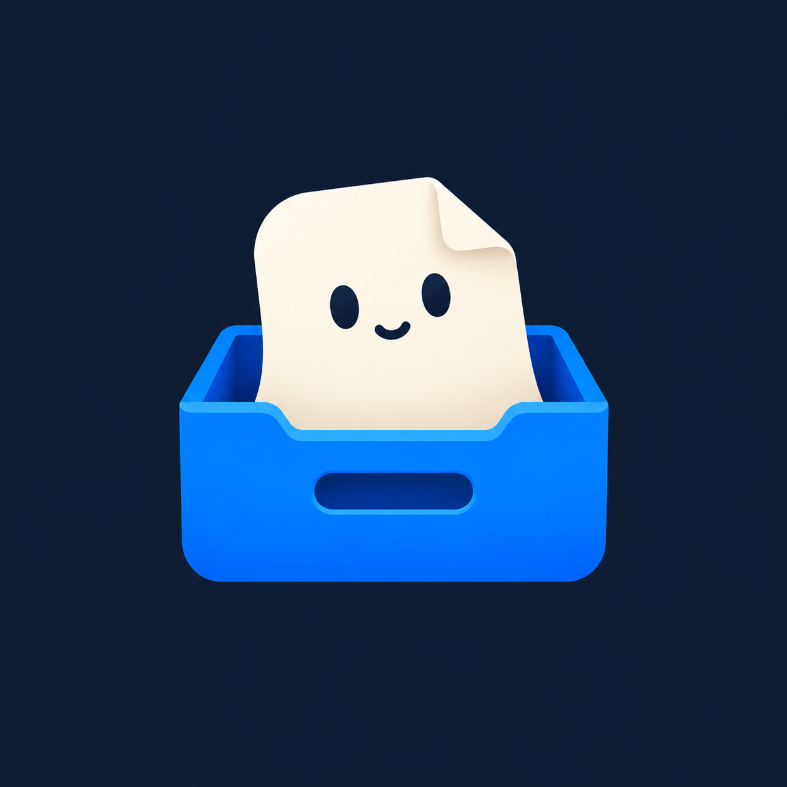

# Snarchive

A local-first Android library for Snapchat Memories exports.

Import your downloaded exports, browse photos and videos with their matching overlays, and keep the original files
under your control. Snarchive requires no account, subscription or application backend. It does not connect to your
Snapchat account or download memories for you.

Snarchive is independent of Snapchat and is not affiliated with or endorsed by Snap Inc.

## Features

- Import multiple export ZIPs or an extracted export folder in one flow.
- Show matching caption and sticker overlays in previews and the fullscreen viewer without rewriting originals.
- Browse a continuous timeline with a draggable date handle, media filters, favourites and **On this day**.
- Swipe between memories, zoom photos, play videos and open details with an upward swipe.
- Permanently delete individual memories after confirmation, or reset the library from Settings.
- Save portable backups, verify and merge backups, and check or repair stored originals.
- Choose system, light or dark appearance.

## Getting started

1. Download your Memories export from Snapchat. Keep the ZIP parts compressed.
2. In Snarchive, choose **Add**, select the export ZIPs and review the import summary.
3. Confirm the import. Snarchive copies the media it preserves into its own storage; your selected exports stay unchanged.
4. Browse your library. Matching overlays are shown by default.

For extracted exports, select the folder containing the media at the expected relative paths. Selecting a folder
of ZIPs does not import those archives recursively; select the ZIP files directly.

See the [user guide](docs/user-guide.md) for overlays, deletion, backups and troubleshooting.

## Platform support

Android is the supported implementation. The current version is **0.2.9**. Standalone build tooling currently targets
ARM64; the declared minimum Android API is 24. Automated tests and API 35 emulator checks cover the documented
flows. Hardware, storage-provider and accessibility coverage is still limited.

[iOS support is deferred](docs/issues/ios-support.md). Android test results do not establish working iOS import,
preservation or restore. See the [testing guide](docs/testing.md) for the verification scope and known gaps.

To build an APK, follow the [Android build guide](docs/android-builds.md). Use a persistent signing key for an
installation that will hold a real library. Shared-template-key preview builds are for disposable test data only.

## Storage and privacy

Original export documents are read, not moved or edited. Preserved files live in app-private storage, and different
memories can share identical stored bytes. Overlays remain separate originals; the viewer and preview renderer
compose them for display.

Keep an independent copy of your exports. Uninstalling the app or losing the device can remove the local library.
Portable backups are **unencrypted**. The app does not provide an app lock, additional storage encryption or
screen-capture protection. Internet capability remains in the Android manifest even though local library flows do
not require a server. See [privacy and permissions](docs/privacy.md).

## Development

```sh
git clone https://github.com/alkval/snarchive.git
cd snarchive
npm ci
npm run check
```

Use Node.js 22.18 or newer. Native Android work also needs JDK 17 and the Android SDK required by the pinned Expo
configuration. Native source belongs in `modules/snarchive-sources/`; generated `android/` and `ios/` directories
are ignored.

- [Development setup](docs/development.md)
- [Android builds and signing](docs/android-builds.md)
- [Architecture](docs/architecture.md)
- [Testing and synthetic fixtures](docs/testing.md)
- [Portable backup format](docs/backup-format.md)
- [Roadmap](docs/roadmap.md)

## Contributing

Bug reports, tests, documentation and focused pull requests are welcome. Start with [CONTRIBUTING.md](CONTRIBUTING.md).
Use synthetic fixtures in tests and reports; never attach private exports, photos, location metadata, signed URLs or
signing keys. Report vulnerabilities according to [SECURITY.md](SECURITY.md).

## License

[MIT](LICENSE). Dependency attribution is listed in [THIRD_PARTY_NOTICES.md](THIRD_PARTY_NOTICES.md).
